# Guía Semana 07 - Cómo configurar un VM para Broker Remoto

En esta guía se explicará cómo es el procedimiento para crear una máquina virtual (VM) en los servicios de Amazon Web Services (AWS).

Se espera que se haya creado ya una cuenta en: https://aws.amazon.com/es/free/ 

Y se haya iniciado sesión con el modo de acceso **Usuario Raiz - root**. Este modo en AWS es el que permite ingresar con el correo electrónico propietario. Hay otro método que se llama el *Usuario IAM* que sirve para usuarios adicionales creados dentro de la cuenta AWS con permisos específicos (véanlo como un acceso alternativo que usted como dueño de una cuenta en AWS le da a otra persona para que administre sus VM).

> Para esta práctica usaremos el plan gratuito de AWS. Es probable que le pida poner una tarjeta de crédito, pero es solo para validar que es una persona real. El plan gratuito le otorga a cada cuenta 100 USD para gastar. Eso es suficiente.

Cuando inicie sesión, deberá aparecerle algo similar a esto: 
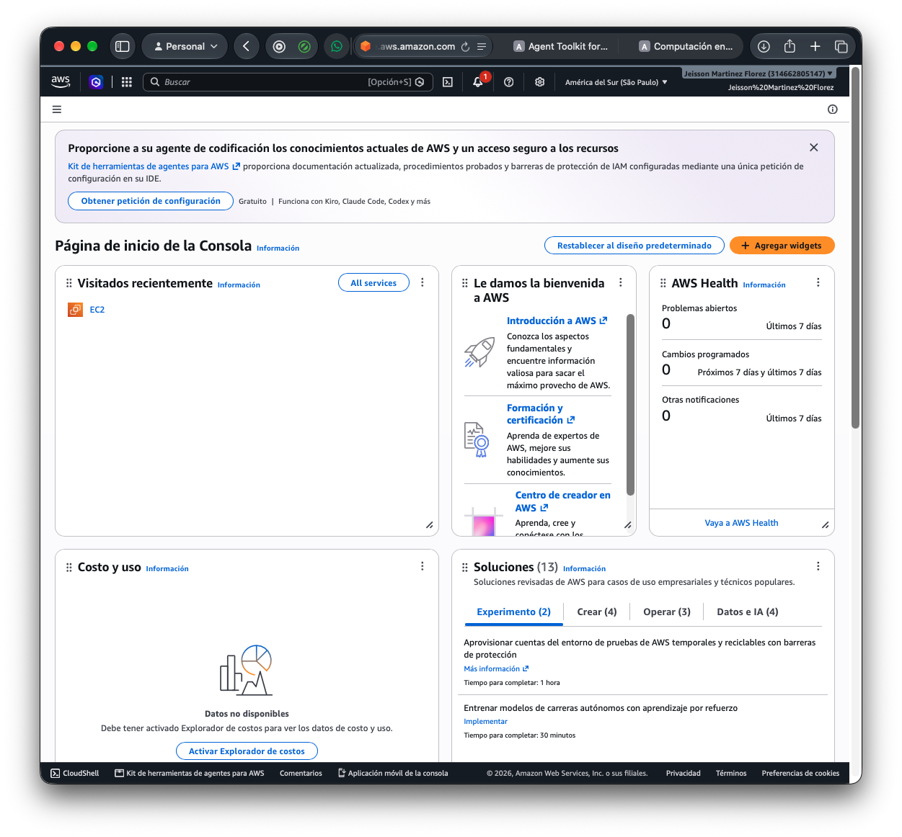


## ¿Qué es lo que vamos a hacer?
Principalmente, vamos a crear una máquina virtual (VM). Esta máquina virtual será un computador remoto donde instalaremos Docker y se ejecutará Mosquitto como broker MQTT para enlazar los dispositivos que queramos.

El siguiente esquema lo representa: 
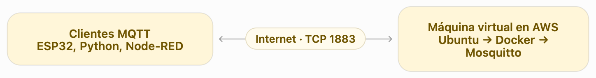

AWS proporciona el computador y la red. Las VM se crean con sistema operativo Linux mediante la distribución Ubuntu. Docker ejecutará el contenedor de Mosquitto. Mosquitto será el broker encargado de recibir los mensajes publicados por los clientes y los distribuirá a quienes se suscriban a los tópicos.

## Paso previo: Configurar la región en América del Sur - Sao Paulo
En la parte superior derecha, en la barra de navegación principal, buscar el selector de región y seleccionar:
América del Sus - Sao Paulo.

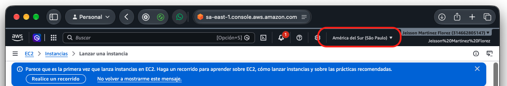

## Crear un servicio EC2
El servicio EC2 significa *Elastic Compute Cloud*. Sirve para crear y adminisitrar computadores virtuales o VM. AWS llama **instancia** a cada una de esas máquinas.

Por lo tanto, cuando se dice:
> "lanzar una instancia"

Se refiere a crear y encender un computador virtual con las características que elegimos.

El proceso para crearla es el siguiente:

Busque **EC2** en la barra superior → **Lanzar instancia** (color naranja).

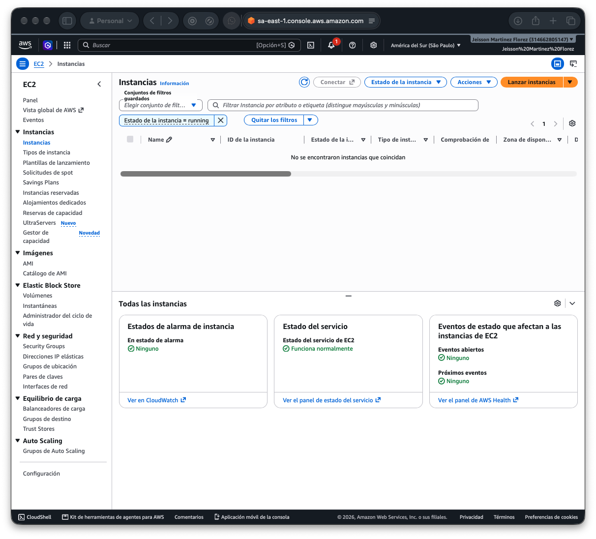

En el formulario que aparece, se deben seleccionar las siguientes opciones:

| Campo | Valor |
|---|---|
| Nombre | `vm-broker-uns` |
| Imagen (AMI) | **Ubuntu Server 24.04 LTS**, con la etiqueta *Apto para la capa gratuita* |
| Tipo de instancia | **t3.micro** (o `t4g.micro` si la AMI es ARM). Debe decir *Apto para la capa gratuita* |
| Par de claves | **Crear nuevo par de claves** → nombre `clave-broker`, tipo RSA, formato **.pem** → se descarga solo. **No se puede volver a descargar** |
| Almacenamiento | Deje los 8 GB gp3 por defecto |

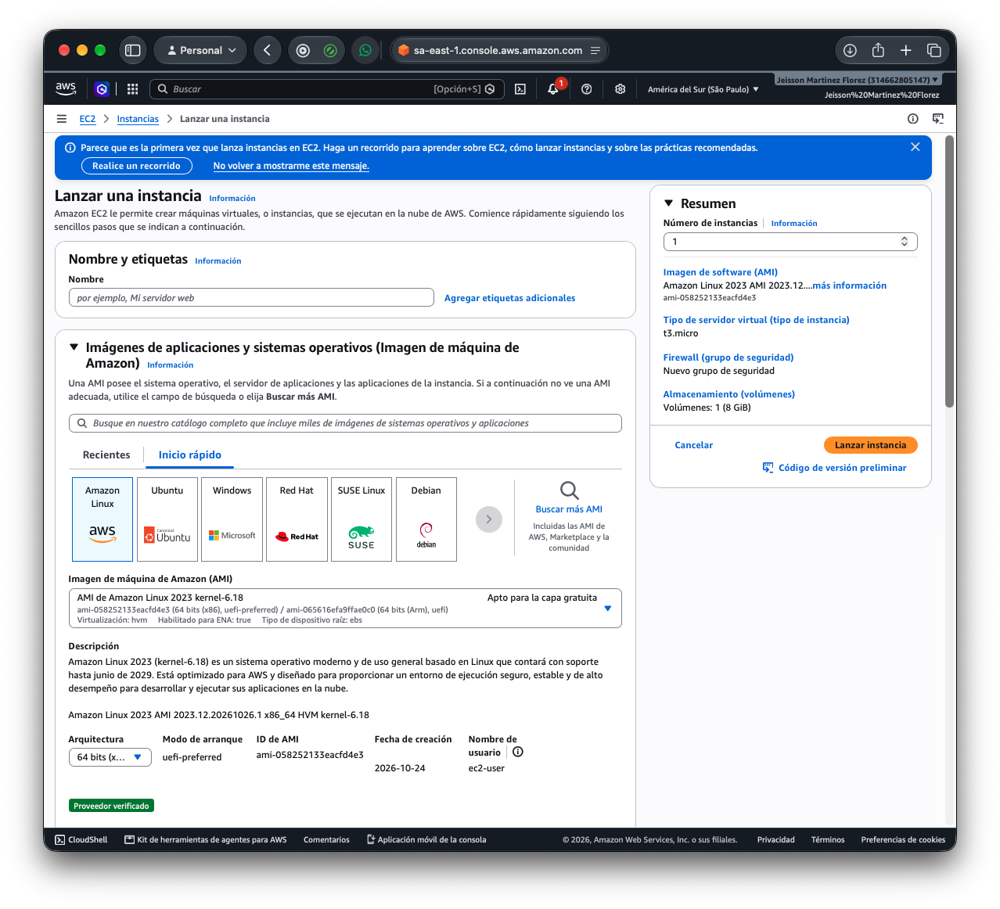

Pasos de configuración:
1. Nombre
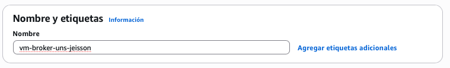

2. Imágenes de aplicaciones y sistemas operativos
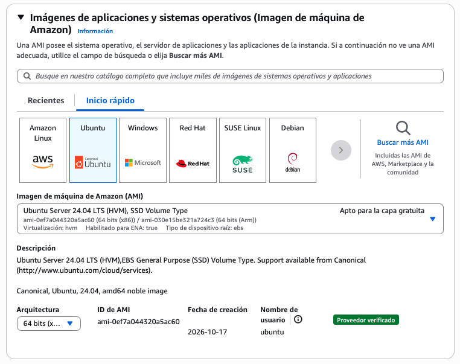

3. Tipo de Instancia
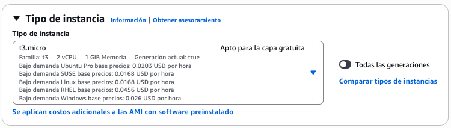

4. Par de claves
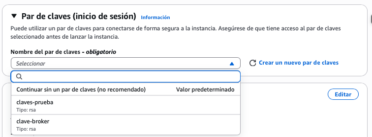

5. Configuraciones de red (pulsar en editar) - Configurar conforme las instrucciones explicadas más abajo.
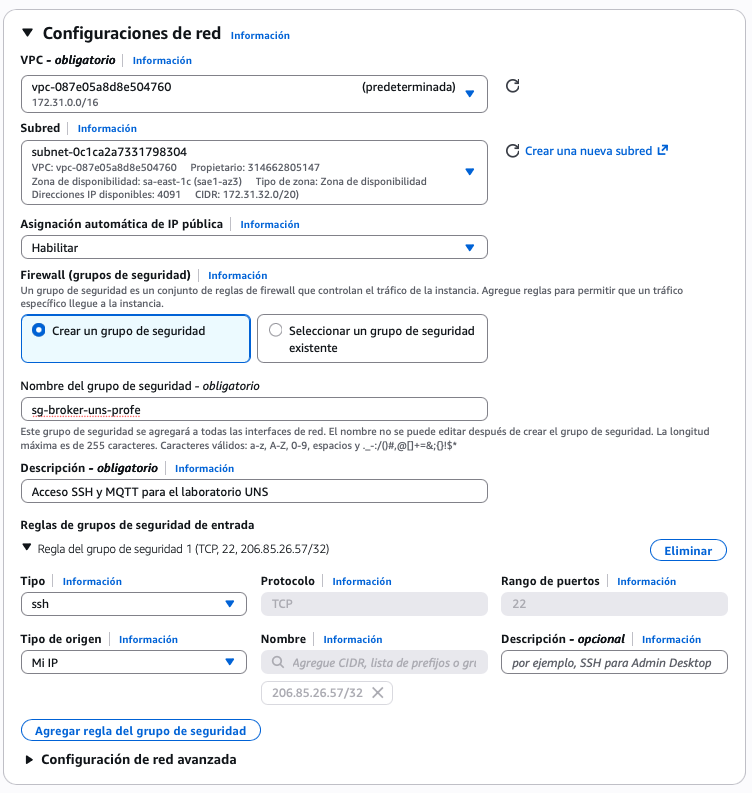

6. Configurar almacenamiento
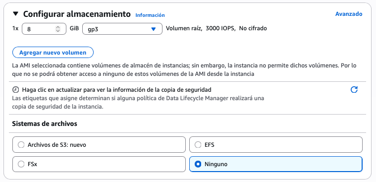

7. Detalles avanzados - No se cambian se dejan los predeterminados
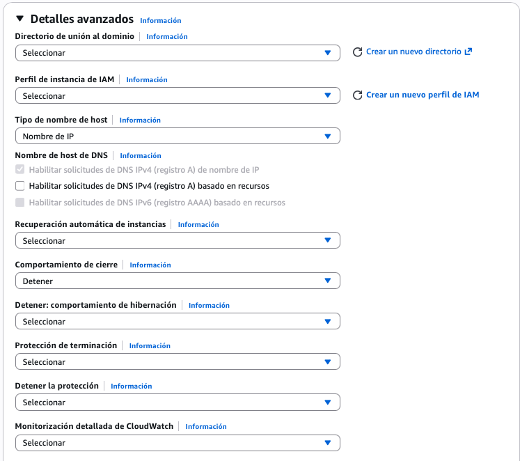

8. Pulsar en Lanzar instancia y revisar resumen
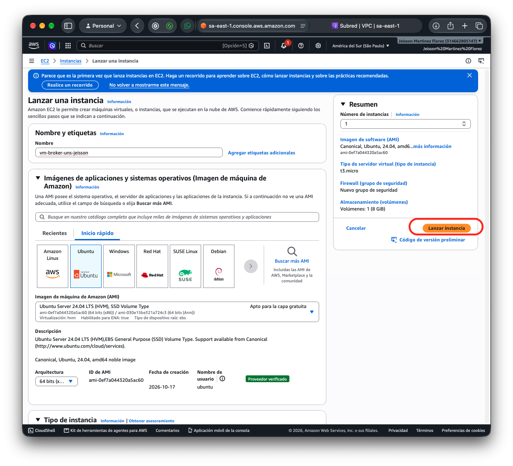

9. Confirmación de lanzamiento
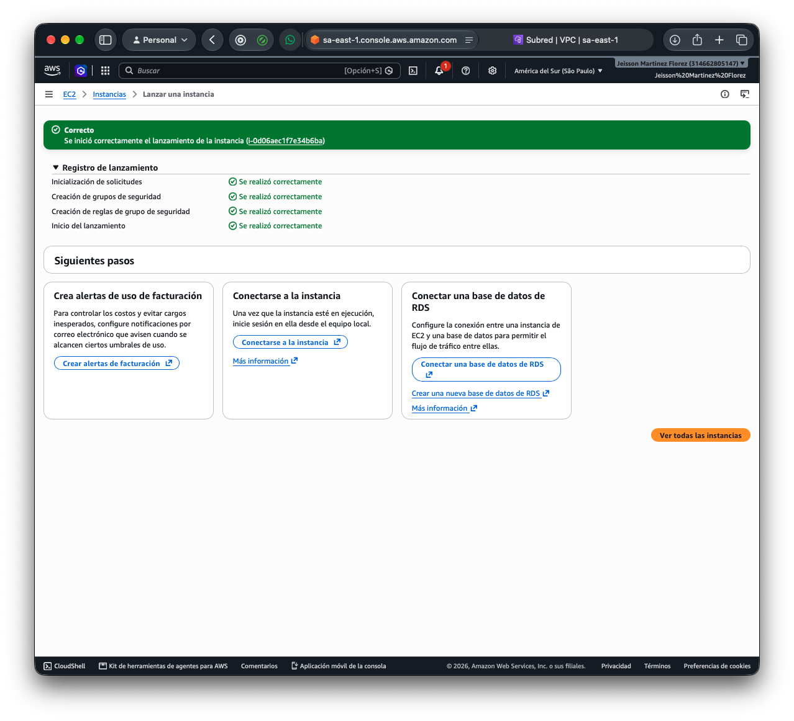

10. Volver al menú de Instancias - Seleccionar la recién creada


11. Comprobar que arrancó
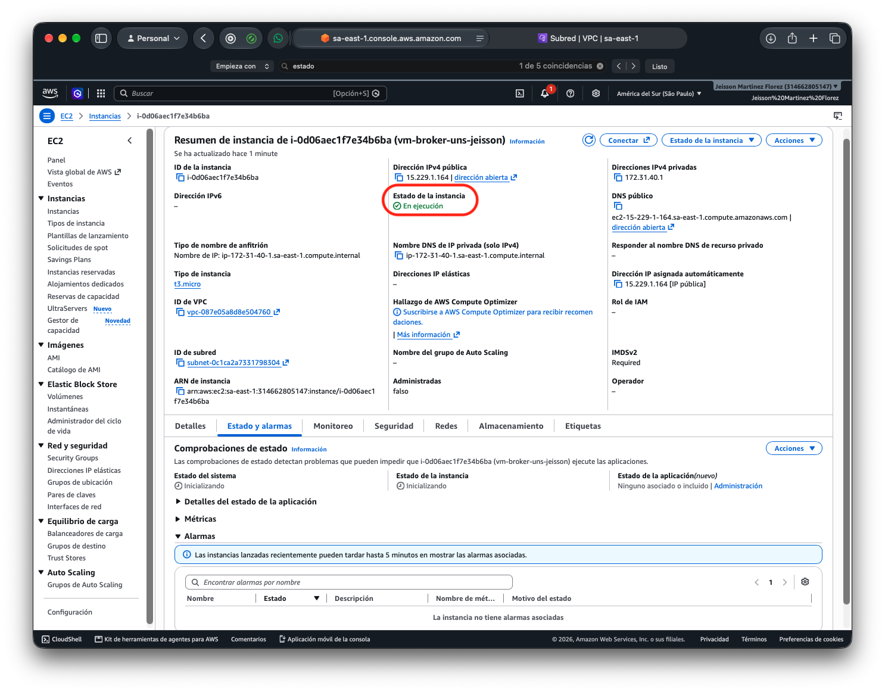


### Algunos conceptos y explicaciones

#### 1. La AMI
Es la plantilla utilizada para preparar el disco inicial de la máquina. Al elegir Ubuntu, significa que la instancia arrancará con ese sistema operativo instalado.

El sistema operativo seleccionado es **Ubuntu Server** que es el OS orientada a servidores. 

Esa instancia de VM que se lanza, la vamos a controlar y administrar desde una terminal. Entonces usaremos el soporte LTS (Long Term Support).

#### 2. Tipo de Instancia
Determina la capacidad de procesamiento y memoria. Una **t3.micro** tiene 2 procesadores virtuales (vCPU) y 1 GiB de memoria RAM. Esas capacidades son más que suficientes para contener un Docker con broker Mosquitto.

#### 3. Par de Claves
Crear el par de claves es un mecanismo para demostrar la identidad de nosotros al conectarnos por SSH; que es el protocolo para administrar la VM mediante una terminal.

Un par de claves tiene dos partes:
- La *Clave pública*: que queda configura la VM.
- La *Clave privada*: que se descarga a nuestro computador dentro de un archivo `.pem`

Durante la creación de una **Instancia** se puede seleccionar un par de llaves ya creado o crear uno nuevo.

Si se crea uno nuevo, durante la creación de instancia o después, se configura: el nombre, el tipo y el formato.

> Sea que ya se tenga un par de claves o que se cree uno nuevo, lo importante es tener el `.pem` guardado, porque es el que va a permitir la conexón SSH con el VM.

Los siguientes pasos muestran cómo crearla después de instanciada una VM.

El proceso para crearla, una vez ya está creada la instancia EC2, es:
1. Buscar el listado de instancias creadas (https://sa-east-1.console.aws.amazon.com/ec2/home?region=sa-east-1#Instances:instanceState=running)

2. Ubicar la instancia deseada.


3. Ingresar a la instancia a la que se le quieren crear el par de claves.

4. Ubicar la opción de Par de Llaves
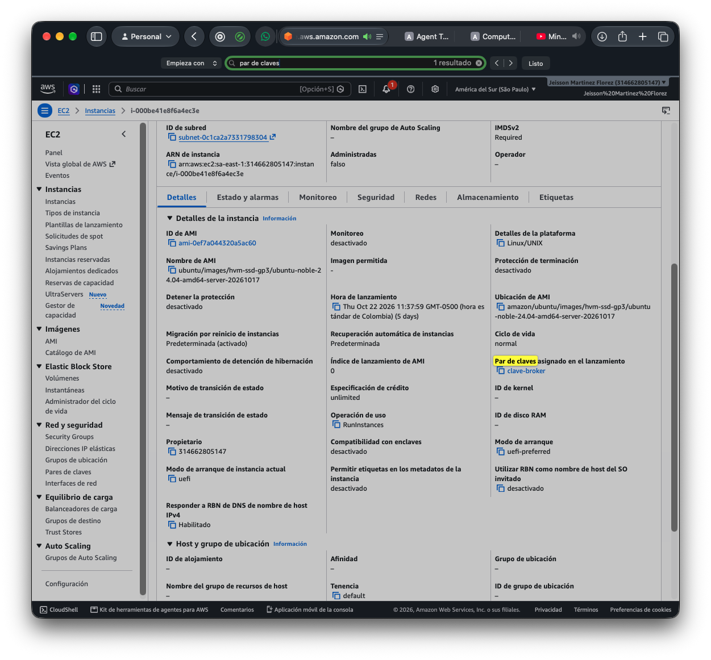

5. Elegir opción "Crear par de claves"

6. Configurar parámetros
Nombre: *Colocar uno acorde al objetivo*
Tipo: *RSA*
Formato: `.pem`
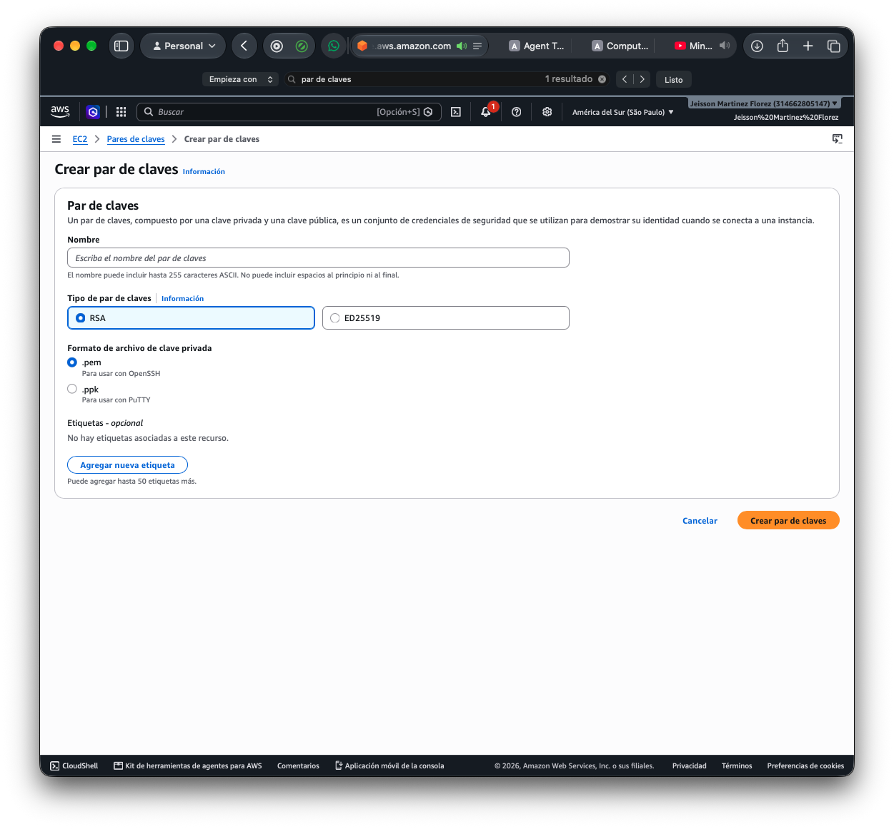

7. Guardar el archivo `.pem` con par de claves

Ese archivo se debe guardar bien y en un lugar seguro.
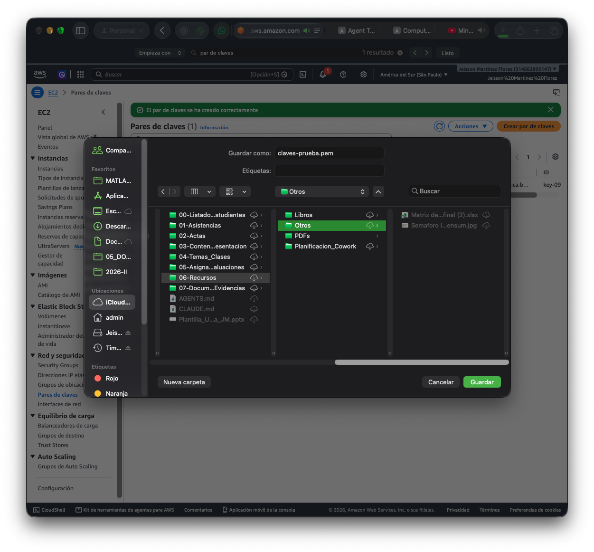


#### 4. Configuración de red
La configuración de red determina **cómo llega una conexión** desde internet hasta la máquina virtual que creamos y qué servicios podrá utilizar. 

Para esta práctica, necesitamos dos accesos:
- Poder entrar a Ubuntu para instalar y administrar el software a usar.
- Los dispositivos que queremos conectar a Mosquitto para intercambiar mensajes MQTT.

Pasos para configurar la red:
1. **Seleccionar el VPC: la red donde estará la VM**

VPC significa *Virtual Private Cloud*, o nube privada virtual. Es una red virtual de nuestra cuenta dentro de AWS.

Se puede entender como la red de un laboratorio. Dentro de ella se puede tener varias máquinas que se comuniquen entre sí. En este caso, nosotros vamos a decidir cómo se conectan con otras redes y con internet. 

> Lo siguiente aplica durante el proceso de creación de la VM

En: **Configuración de red -> Editar -> VPC**. Se selecciona el VPC predeterminada.

2. **Seleccionar la Subred**

Se selecciona una de las tres que aparecen. Si se desea verificar que sea la correcta, el requisito es que permitan una ruta hacia internet. Para saberlo, se pueden seguir estos pasos en una ventana del navegador diferente:

- Buscar "VPC"
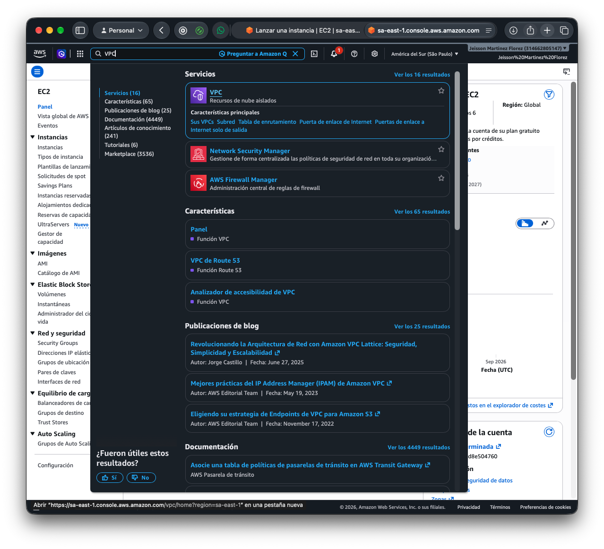

- Seleccionar menú "Subredes"
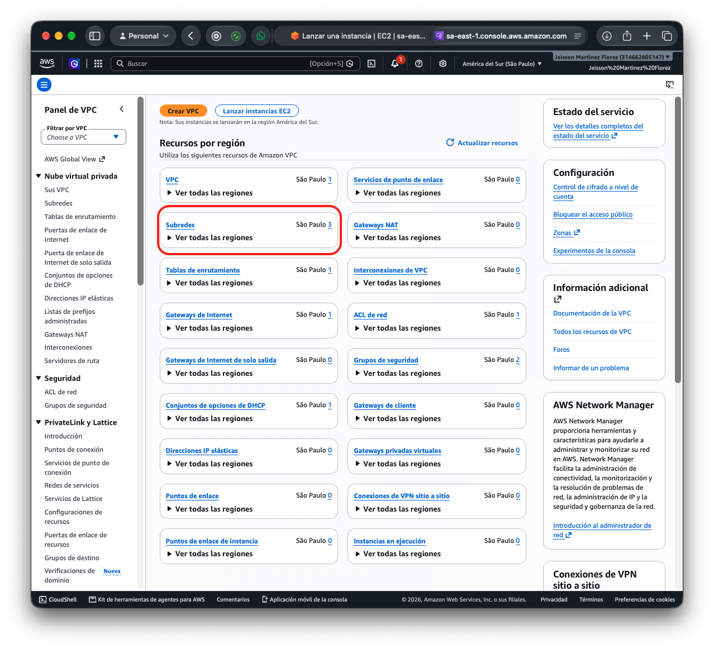

- Elegir una de las 3 opciones para validar
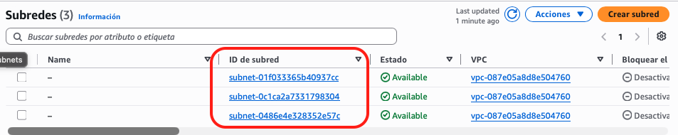

¿Por qué hay tres opciones? Bueno porque los centros de datos donde AWS tiene los VM o servidores, tienen varias zonas de disponibilidad en ubicaciones aisladas unas de otras dentro de la misma región. Entonces para la zona de Sao Paulo, hay tres diferentes subzonas de disponibilidad:

| Zona | Rango de Direcciones de la subred |
| --- | --- |
| `sa-east-1a` | `172.31.0.0.0/20` | 
| `sa-east-1b` | `172.31.16.0.0/20` | 
| `sa-east-1c` | `172.31.32.0.0/20` | 


- Buscar la tabla de enrutamiento y buscar que tenga la ruta `0.0.0.0/0` con un destino que comience por `igw-`. 
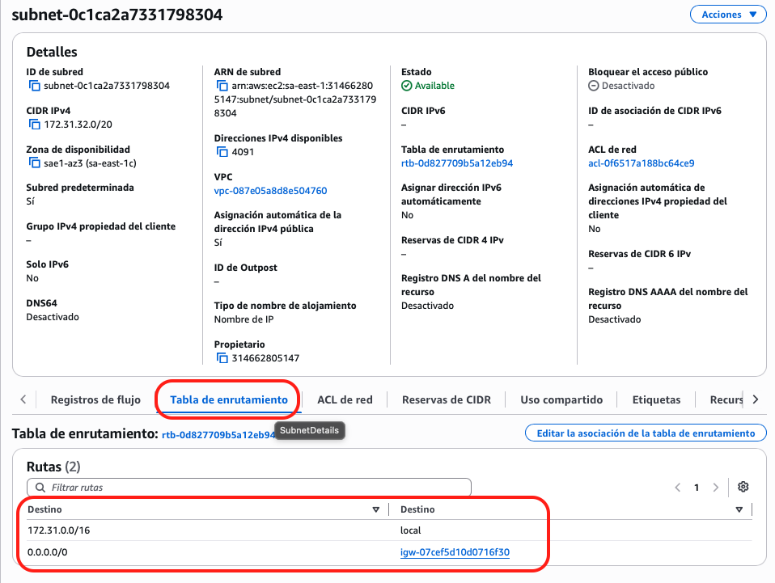

Una ruta `0.0.0.0/0` es camino hacia internet mediante una *Internet Gateway* o puerta de enlace de Internet. El identificador `igw-` corresponde a la Internet Gateway.

Básicamente, significa: *para llegar a cualquier dirección IPv4 que no tenga una ruta más específica, se utilizará esta puerta de enlace a internet*. 

La otra ruta, en este caso la `172.31.0.0/16`, es una dirección privada, es la local, es decir, la red propia de la VPC y cuyo destino no es internet, sino la comunicación interna.

3. **Habilitar la Asignación automática de IP pública**

Para poder localizar la VM desde nuestro computador y desde los clientes MQTT.

4. **Crear un grupo de seguridad en Firewall**

Se crea uno para definir los accesos de esta VM. Se le puede poner como nombre algo como: `broker-uns` y si pide una descripción poner algo como `Acceso SSH y MQTT para el laboratorio UNS`. 

En las reglas de entrada, configurar:

| Tipo | Protocolo | Puerto | Origen | 
| --- | --- | --- | --- | 
| SSH | TCP | 22 | Mi IP | 

Con esta regla, se permite que nuestro computador entre a Ubuntu por SSH. La clave `.pem` se utilizará después para autenticarnos.

Por ahora, se deja solo esa entrada. Después agregaremos **TCP 1883** cuando Mosquitto esté configurado con autenticación, antes de probarlo desde fuera de AWS.


#### 5. Configuración del Almacenamiento
El disco raíz contiene Ubuntu y después le agregaremos Docker, las imágenes y los archivos del broker. 

Se configura así:

| Campo | Valor |
| --- | --- |
| Capacidad | 8 GiB, si la imagen lo permite | 
| Tipo | gp3 |
| Cantidad de discos | Uno |

Si la AMI exige una capacidad mínima mayor, se respeta ese mínimo. No se necesita añadir otro volumen, aumentar el rendimiento ni cambiar opciones avanzadas.

Si aparece *Eliminar al terminar*, dejarla activada significa que el disco se eliminará cuando se termine (cancele) la instancia. 


#### 6. Comprobación de arranque

Cuando se revisa el listado de instancias y se selecciona la recién creada, se ingresa al menú interno de dicha instancia y se observa que esté:

> **Estado de la instancia**: en Ejecución.

Y también se puede revisar el menú de "Estado y Alarmas" en Comprobaciones de Estado, y validar que no salte ninguna alerta.


#### 7. Ajustar permisos de par clave en nuestro computador

En Windows, desde la terminal PowerShell, nos debemos ubicar en la carpeta donde guardamos nuestra `clave-broker.pem` y allí ejecutar:

```powersheell
# Identifica al usuario actual de Windows
$usuarioActual = whoami

# Concede lectura al usuario actual
icacls .\clave-broker.pem /grant:r "${usuarioActual}:(R)"

# Elimina los permisos heredados de la carpeta
icacls .\clave-broker.pem /inheritance:r
```

Con esto, lo que hacemos es ajustar los permisos del archivo de clave para que otros usuarios del computador no puedan leerla, porque es privada.

Esos comandos incluyen:
- `icacls` administra permisos de archivos en Windows.
- `(R)` concede lectura.
- `/grant:r` reemplaza los permisos explícitos de ese usuario.
- `/inheritance:r` elimina los permisos que el archivo recibió de la carpeta que lo contiene.


Después de ejecutado, se puede verificar con:
```powershell
icacls .\clave-broker.pem
```

*Nota:* Si aparecen permisos explícitos para otros usuarios o grupos, los comandos anteriores no los eliminan. En ese caso, deben revisar clic derecho sobre el archivo → Propiedades → Seguridad → Opciones avanzadas, para retirar accesos adicionales que permitan leer la clave.

**En MacOS** el procedimiento se realiza solo con el siguiente comando en la terminal zsh:

```zsh
chmod 400 clave-broker.pem
```

#### 8. Verificar la conexión con el VM por Ubuntu terminal y SSH

Hecho lo anterior, se debe verificar la conexión con la Instancia VM creada. Para eso, se debe anotar la **IPv4 pública** que aparece aquí:
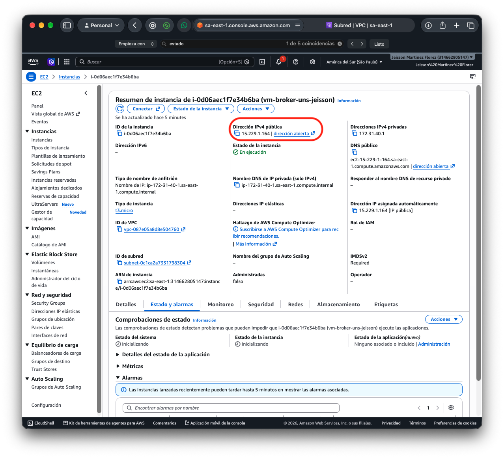

Ahora, en nuestro computador, debemos ingresar desde la terminal hasta la ubicación donde guardamos el archivo `.pem` del par de claves.

Estando en esa ubicación, realizamos la conexión con el siguiente comando:

```zsh
ssh -i clave-broker-profe.pem ubuntu@IP_PUBLICA
```

El nombre del archivo debe coincidir con el `.pem` de ustedes y `IP_PUBLICA` debe sustituirse por la dirección de la nueva instancia de ustedes. 

Deberá salir algo como esto:

```zsh
admin@MacBook-Pro-de-Admin Semana_7 % ssh -i clave-broker.pem ubuntu@15.229.1.164
Welcome to Ubuntu 24.04.5 LTS (GNU/Linux 7.0.0-1014-aws x86_64)

 * Documentation:  https://help.ubuntu.com
 * Management:     https://landscape.canonical.com
 * Support:        https://ubuntu.com/pro

 System information as of Tue Oct 27 12:29:04 UTC 2026

  System load:  0.0               Temperature:           -273.1 C
  Usage of /:   29.6% of 6.71GB   Processes:             114
  Memory usage: 24%               Users logged in:       0
  Swap usage:   0%                IPv4 address for ens5: 172.31.40.1

Expanded Security Maintenance for Applications is not enabled.

0 updates can be applied immediately.

Enable ESM Apps to receive additional future security updates.
See https://ubuntu.com/esm or run: sudo pro status


The list of available updates is more than a week old.
To check for new updates run: sudo apt update


The programs included with the Ubuntu system are free software;
the exact distribution terms for each program are described in the
individual files in /usr/share/doc/*/copyright.

Ubuntu comes with ABSOLUTELY NO WARRANTY, to the extent permitted by
applicable law.

To run a command as administrator (user "root"), use "sudo <command>".
See "man sudo_root" for details.

ubuntu@ip-172-31-40-1:~$ 
```

Y nuestra terminal ya queda disponible para enviar comandos a nuestra Instancia VM.

Después instalaremos Docker y configuraremos Mosquitto.


## Instalar Docker

Estos pasos siguientes se deben hacer con la conexión establecida con nuestra Instancia VM por la terminal usando el comando:

```zsh
ssh -i clave-broker-profe.pem ubuntu@IP_PUBLICA
```

El nombre del archivo debe coincidir con el `.pem` de ustedes y `IP_PUBLICA` debe sustituirse por la dirección de la nueva instancia de ustedes. 

Hecha la conexión, a partir de ahora todos los comandos que coloquemos en la terminal se ejecutan en AWS, no en nuestro computador.

Lo que veremos cuando estemos conectados es algo como esto: `ubuntu@ip-172-31-40-1:~$ ` 

La IP privada 172.31.40.1 que muestra Ubuntu y la IP pública 15.229.1.164 que se usó para conectarte pertenecen a la misma instancia. La privada sirve dentro de la VPC; la pública permite llegar desde Internet.

Ahora, Docker:
> Recordemos que docker ejecutará Mosquitto dentro de un contenedor, que es un proceso aislado que incluye el software y sus dependencias. 

**Docker compose** permite iniciar ese contenedor a partir del archivo de configuración que tenemos compartido en el repositorio.

1. Actualizar la lista de paquetes

En la terminal de Ubuntu:

```zsh
sudo apt update
``` 

`apt` es el gestor de paquetes de Ubuntu. Este comando consulta qué versiones están disponibles; por sí solo no instala las actualizaciones.

2. Instalar Docker siguiendo el método ya planteado en la guía previa

Descargar el instalador oficial:

```zsh
curl -fsSL https://get.docker.com -o /tmp/get-docker.sh
``` 

Luego ejecutarlo:

```zsh
sudo sh /tmp/get-docker.sh
```

`curl` descarga el archivo y `sudo sh` lo ejecuta con permisos de administrador. Este instalador requiere conexión a Internet.

3. Permitir que el usuario `ubuntu` utilice Docker

```zsh
sudo usermod -aG docker ubuntu
```

Esto agrega `ubuntu` al grupo `docker`. Ese grupo concede un control amplio sobre la máquina, así que solo debe incluir usuarios de confianza.

Para que la sesión reconozca el nuevo grupo, nos debemos salir y volver a ingresar.

Para salir: 
```zsh
exit
```

Volver a ingresar como al inicio:

```zsh
ssh -i clave-broker-profe.pem ubuntu@IP_PUBLICA
```

El nombre del archivo debe coincidir con el `.pem` de ustedes y `IP_PUBLICA` debe sustituirse por la dirección de la nueva instancia de ustedes.

4. Comprobar la instalación

Ya dentro de Ubuntu, se debe ejecutar:

```zsh
docker --version
docker compose version
docker run --rm hello-world
```

Los dos primeros muestran las versiones. El tercero descarga y ejecuta un contenedor de prueba; debe mostrar “Hello from Docker!”.

`--rm` elimina ese contenedor al terminar, aunque conserva la imagen descargada.

Cuando pase esta comprobación, tendremos Ubuntu y Docker funcionando.


## Configurar Mosquitto

Estos pasos parten de que ya funcionó la prueba `hello-world` de Docker en el último paso.

1. Descargar el repositorio en la VM

Ejecutamos el siguiente comando dentro de Ubuntu:

```zsh
cd ~
git clone https://github.com/JeissonMartinez/automatizacion-inteligente-2026-2.git
```

`git clone` descarga una copia del repositorio.


2. Preparar una carpeta independiente para el broker

```zsh
mkdir -p ~/broker-uns/mosquitto/config

cp ~/automatizacion-inteligente-2026-2/codigo/semana-07-servidor-nube/docker-compose.yml \
   ~/broker-uns/docker-compose.yml

cp ~/automatizacion-inteligente-2026-2/codigo/semana-07-servidor-nube/mosquitto.conf \
   ~/broker-uns/mosquitto/config/mosquitto.conf

cd ~/broker-uns
```

Estos comandos crean esta estructura en el VM:

```text
/home/ubuntu/broker-uns/
├── docker-compose.yml
└── mosquitto/
    └── config/
        └── mosquitto.conf

```

- `mkdir -p` crea carpetas, incluidas las intermedias que falten.
- `cp` copia archivos.
- `docker-compose.yml` describe cómo ejecutar el servicio.
- `mosquitto.conf` establece cómo se comportará el broker

La configuración ya contiene:

```zsh
allow_anonymous false
password_file /mosquitto/config/passwd
````

Eso significa: rechazar conexiones anónimas y consultar los usuarios en el archivo `passwd`. Que ahora debemos crearlo.


3. Descargar la imagen de Mosquitto

Desde la ruta `~/broker-uns` ejecutar:

```zsh
docker compose pull
```

Una imagen es la plantilla del software que ejecutará Docker. Aquí se utiliza `eclipse-mosquitto:2`, la imagen oficial de Mosquitto de la serie 2.

Todavía no estamos arrancando el broker.


4. Crear nuestro usuario del broker

Desde la ruta `~/broker-uns` ejecutar:

```zsh
docker run --rm -it \
  -v "$PWD/mosquitto/config:/mosquitto/config" \
  eclipse-mosquitto:2 \
  mosquitto_passwd -c /mosquitto/config/passwd profe
```

Nos pedirá escribir una contraseña y repetirla. Es normal que no aparezcan caracteres al teclearla. Usen una contraseña exclusiva para este laboratorio.

El comando significa:
| Parte | Función |
|---|---|
| `docker run` | Ejecutar un contenedor. |
| `--rm` | Eliminar ese contenedor al terminar. |
| `-it` | Permitir la interacción por terminal. |
| `-v …` | Conectar una carpeta de Ubuntu con una carpeta del contenedor. |
| `mosquitto_passwd` | Herramienta para administrar usuarios de Mosquitto. |
| `-c` | Crear el archivo de contraseñas. |
| `profe` | Nombre del usuario que estamos creando. |


El usuario MQTT `profe` es distinto del usuario Linux `ubuntu`. Uno permite conectarse al broker; el otro permite administrar la VM.

El archivo `passwd` almacena verificadores de contraseña mediante hash, no las contraseñas en texto visible. Aun así, debemos protegerlo.

Para agregar posteriormente otro usuario, ejecuta el mismo comando sin `-c` y cambia profe por su nombre. Repetir `-c` sobrescribe el archivo y elimina los usuarios anteriores.


5. Ajustar los permisos

```zsh
sudo chown 1883:1883 mosquitto/config/passwd
sudo chmod 600 mosquitto/config/passwd
```

En la imagen oficial, Mosquitto utiliza el identificador de usuario **1883**. Aquí ese número identifica al usuario del sistema; aunque coincide con el puerto MQTT, son conceptos diferentes.
- `chown` cambia el propietario del archivo para que Mosquitto pueda leerlo.
- `chmod 600` permite únicamente al propietario leerlo y modificarlo.


6. Iniciar el broker 

```zsh
docker compose config --quiet
````

Comprueba que el archivo de Compose sea válido. Si termina sin mostrar errores, entonces ejecutar:

```zsh
docker compose up -d
```

`up` crea e inicia el servicio; `-d` lo deja funcionando en segundo plano.


Después lo podemos consultar:

```zsh
docker compose ps
docker compose logs --tail 40 mosquitto
```

Y debemos ver el contenedor `ai-mosquitto` activo y un registro parecido a:

```text
Opening ipv4 listen socket on port 1883.
```

Si aparece Restarting o errores al leer passwd, se debecorregir antes de continuar. [Consultar-Investigar].


7. Comprobar que rechaza conexiones sin credenciales

Ejecutar:

```zsh
docker exec ai-mosquitto \
  mosquitto_sub -h localhost -t 'prueba/#' -W 5
```

`docker exec` ejecuta una orden dentro del contenedor existente. `mosquitto_sub` intenta suscribirse a mensajes; aquí lo hacemos intencionalmente sin usuario ni contraseña.

El resultado esperado es un rechazo parecido a:

```text
Connection error: Connection Refused: not authorised
```

En esta prueba, el rechazo es el resultado correcto: demuestra que el broker no permite acceso anónimo.


## Conexión con Mosquitto con Usuario y Contraseña

Comprobaremos que podemos conectarnos desde nuestro computador con usuario y contraseña, publicar un mensaje y recibirlo.


1. Permitir MQTT en el grupo de seguridad

En la consola de AWS:

- Entrar en EC2 → Instancias y selecciona tu VM.
- Abrir la pestaña Seguridad.
- Pulsar el enlace del grupo de seguridad asociado.
- En Reglas de entrada, pulsar Editar reglas de entrada → Agregar regla.
- Configura:

| Campo | Valor |
|---|---|
| Tipo | **TCP personalizado** |
| Puerto | **1883** |
| Origen | **Mi IP** |
| Descripción | `MQTT desde mi computador` |

Guardar las reglas y conservar la regla SSH del puerto 22.


2. Instalar los clientes MQTT en el computador

Usaremos dos herramientas:
- `mosquitto_sub`: se suscribe a un tópico y muestra los mensajes recibidos.
- `mosquitto_pub`: publica un mensaje en un tópico.

Abrir otra terminal de el computador, dejando abierta la conexión SSH. Comprueba que el indicador muestre algo como (según su pc saldrá algo diferente cuando abra la temrinal):

```zsh
admin@MacBook-Pro-de-Admin …
``` 

Así se sabe que está ejecutando comandos localmente y no en el VM Ubuntu de AWS.


