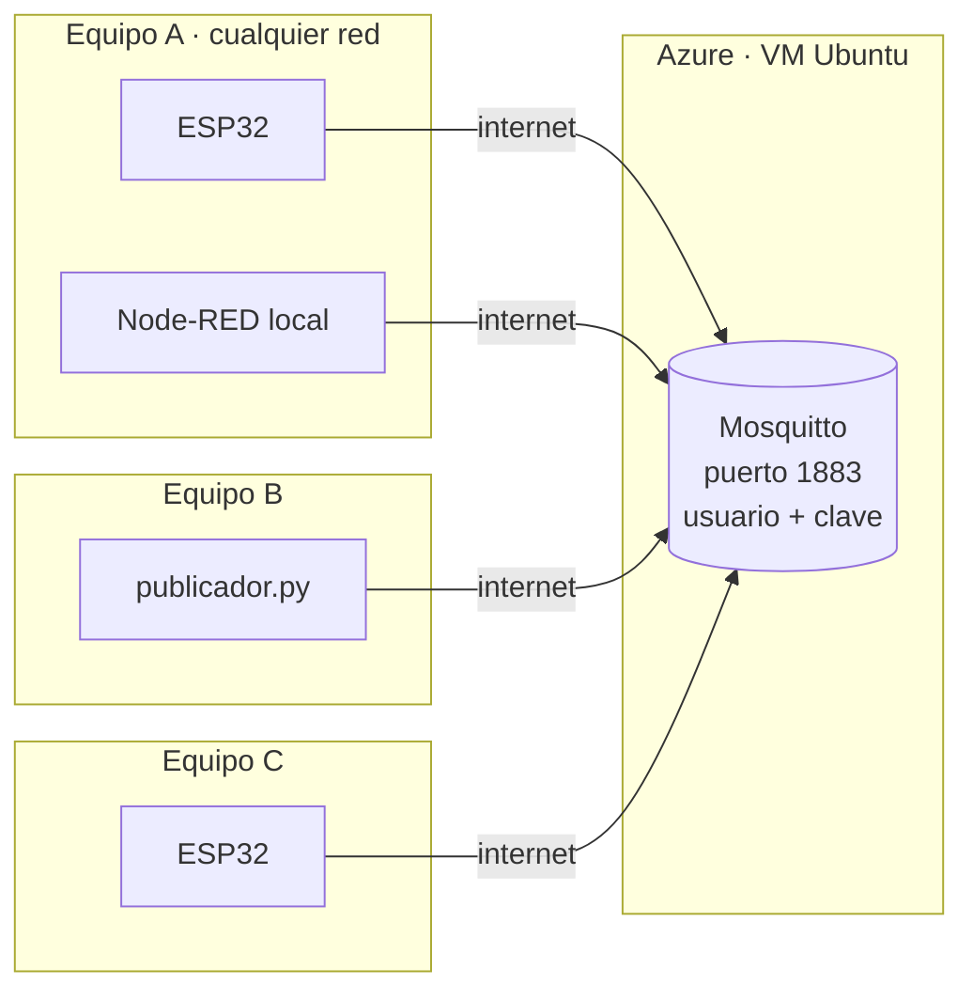

# Broker MQTT del espacio de nombres unificado en la nube

Hasta ahora cada equipo levantaba Mosquitto en su computador y los dispositivos solo se veían dentro de la misma red. Un espacio de nombres unificado (UNS) necesita **un único broker al que todos lleguen desde cualquier red**. En esta sesión lo montamos en una máquina virtual en la nube, gratis, reutilizando la misma imagen `eclipse-mosquitto:2` de la semana 2.



> **Qué cambia respecto al laboratorio:** el broker ya no está en `localhost` ni en una IP `192.168.x.x`, sino en un nombre público como `uns-unipamplona.eastus.cloudapp.azure.com`. Y como queda expuesto a internet, **deja de ser anónimo**.

---

## Por qué Azure for Students

| Opción | ¿Tarjeta? | Ventaja | Limitación |
|---|---|---|---|
| **Azure for Students** (la de esta guía) | No | Se activa con el correo institucional; USD 100 de crédito por 12 meses | Consume crédito: apague la VM al terminar |
| Oracle Cloud Always Free | Sí | Gratis indefinidamente | Suele haber falta de capacidad al crear la VM |
| Google Cloud e2-micro | Sí | Gratis indefinidamente | Solo regiones de EE. UU. y 1 GB de salida al mes |
| `test.mosquitto.org` | No | Cero configuración | Público: cualquiera ve y escribe sus tópicos |

Los pasos 3 a 9 son idénticos en Oracle o Google; solo cambia la consola para crear la VM y abrir el puerto.

---

## Paso 1 · Activar Azure for Students

1. Entre a <https://azure.microsoft.com/es-es/free/students> y pulse **Comenzar gratis**.
2. Inicie sesión con su correo **@unipamplona.edu.co**.
3. Complete la verificación (teléfono y correo). No pide tarjeta.
4. Al terminar, abra <https://portal.azure.com>. En **Suscripciones** debe aparecer *Azure for Students*.

> 📸 **Captura 01** · `img/01-suscripcion-students.png` — página *Suscripciones* mostrando *Azure for Students* activa.

> ⚠️ No active primero la prueba gratuita normal de Azure con el correo institucional: después ya no podrá activar Azure for Students.

---

## Paso 2 · Crear la máquina virtual

En el portal: **Máquinas virtuales → Crear → Máquina virtual de Azure**.

| Campo | Valor |
|---|---|
| Grupo de recursos | Crear nuevo: `rg-uns` |
| Nombre | `vm-broker-uns` |
| Región | `East US` (si da error de política, pruebe otra de la lista permitida) |
| Imagen | **Ubuntu Server 24.04 LTS** |
| Tamaño | El más pequeño de la serie B, por ejemplo **Standard_B1s** (1 vCPU, 1 GB). Sobra para Mosquitto |
| Tipo de autenticación | **Contraseña** (más simple en clase) |
| Usuario | `azureuser` |
| Puertos de entrada públicos | Permitir **SSH (22)** |

Pulse **Revisar y crear → Crear**. Tarda uno o dos minutos.

> 📸 **Captura 02** · `img/02-crear-vm.png` — pestaña *Datos básicos* con imagen y tamaño seleccionados.

---

## Paso 3 · Abrir el puerto 1883

Por defecto Azure solo deja pasar SSH. Hay que abrir MQTT.

1. Abra la VM → **Redes** (o *Configuración de red*) → **Crear regla de puerto → Regla de puerto de entrada**.
2. Configure:

| Campo | Valor |
|---|---|
| Origen | `Any` (o la IP pública de la universidad, más seguro) |
| Intervalos de puertos de destino | `1883` |
| Protocolo | `TCP` |
| Acción | Permitir |
| Nombre | `MQTT-1883` |

> 📸 **Captura 03** · `img/03-regla-1883.png` — formulario de la regla de entrada.

**Para pensar:** esta regla es el equivalente en la nube del error de la semana 2 «`rc=-2` con la IP correcta: el cortafuegos bloquea el 1883».

---

## Paso 4 · Darle un nombre fijo al broker

Una IP se puede olvidar o cambiar; un nombre no.

1. VM → **Información general** → clic en la **dirección IP pública**.
2. **Configuración → Etiqueta de nombre DNS**: escriba `uns-unipamplona` (debe ser único) → **Guardar**.
3. Queda algo como `uns-unipamplona.eastus.cloudapp.azure.com`. Ese será el **host del broker** en todos los clientes.

> 📸 **Captura 04** · `img/04-dns.png` — configuración de la IP pública con la etiqueta DNS.

---

## Paso 5 · Entrar a la VM por SSH

Desde PowerShell (Windows) o la terminal (Linux/macOS):

```bash
ssh azureuser@uns-unipamplona.eastus.cloudapp.azure.com
```

Acepte la huella con `yes` y escriba la contraseña. El indicador cambia a `azureuser@vm-broker-uns:~$`. **Todo lo que sigue hasta el paso 8 se ejecuta dentro de la VM.**

---

## Paso 6 · Instalar Docker

```bash
curl -fsSL https://get.docker.com | sudo sh
sudo usermod -aG docker $USER
exit
```

Vuelva a entrar con `ssh` (para que tome el grupo) y verifique:

```bash
docker --version
docker compose version
```

---

## Paso 7 · Traer la configuración del curso

```bash
git clone https://github.com/JeissonMartinez/automatizacion-inteligente-2026-2.git
cd automatizacion-inteligente-2026-2/codigo/semana-06-broker-nube
```

Compare `mosquitto/config/mosquitto.conf` con el de la semana 2. Las dos líneas que importan:

```conf
allow_anonymous false
password_file /mosquitto/config/passwd
```

---

## Paso 8 · Crear usuarios y levantar el broker

Un usuario por equipo, uno para Node-RED y uno para el docente. `-c` crea el archivo **solo en el primero**.

```bash
CFG=$(pwd)/mosquitto/config
IMG=eclipse-mosquitto:2

docker run --rm -v $CFG:/mosquitto/config $IMG mosquitto_passwd -c -b /mosquitto/config/passwd profe   CAMBIE_ESTA_CLAVE
docker run --rm -v $CFG:/mosquitto/config $IMG mosquitto_passwd    -b /mosquitto/config/passwd equipo-a CLAVE_A
docker run --rm -v $CFG:/mosquitto/config $IMG mosquitto_passwd    -b /mosquitto/config/passwd equipo-b CLAVE_B
docker run --rm -v $CFG:/mosquitto/config $IMG mosquitto_passwd    -b /mosquitto/config/passwd equipo-c CLAVE_C

sudo chown 1883:1883 $CFG/passwd && sudo chmod 0700 $CFG/passwd

docker compose up -d
docker compose logs -f
```

En el registro debe ver `Opening ipv4 listen socket on port 1883`. Salga del registro con `Ctrl+C` (el broker sigue corriendo).

> 📸 **Captura 05** · `img/05-logs-mosquitto.png` — terminal con el broker escuchando en 1883.

> El archivo `passwd` guarda las claves cifradas, pero **no lo suba al repositorio**. Ya está en el `.gitignore` sugerido al final.

---

## Paso 9 · Verificar desde su computador

**a) Puerto abierto**, con el script de siempre:

```bash
python verificar_stack.py uns-unipamplona.eastus.cloudapp.azure.com
```

Mosquitto (MQTT) debe salir en verde. WebSockets y Node-RED saldrán en rojo: es correcto, en la nube solo está el broker.

**b) Suscribirse con credenciales** (sin instalar nada, usando Docker local):

```bash
docker run --rm -it eclipse-mosquitto:2 mosquitto_sub \
  -h uns-unipamplona.eastus.cloudapp.azure.com -u equipo-a -P CLAVE_A \
  -t 'empresa/#' -v
```

**c) Prueba negativa**: repita sin `-u` ni `-P`. Debe responder `Connection Refused: not authorised`. Eso demuestra que el broker ya no es anónimo.

**d) MQTT Explorer**: *Host* = el nombre DNS, *Port* = 1883, *Username/Password* del equipo, sin TLS.

> 📸 **Captura 06** · `img/06-mqtt-explorer.png` — MQTT Explorer conectado mostrando el árbol del UNS.

---

## Paso 10 · Apuntar los clientes al broker en la nube

### ESP32 (`esp32_uns.ino`, bloque 1)

```cpp
const char* BROKER_IP     = "uns-unipamplona.eastus.cloudapp.azure.com";  // ahora es un nombre
const uint16_t BROKER_PUERTO = 1883;
const char* MQTT_USUARIO  = "equipo-a";
const char* MQTT_CLAVE    = "CLAVE_A";   // no la suba al repositorio
```

Y en la función de reconexión (línea ~233) cambie los dos `NULL` por las credenciales:

```cpp
bool ok = mqtt.connect(id.c_str(), MQTT_USUARIO, MQTT_CLAVE, T_ESTADO, 1, true, "offline");
```

`setServer()` de PubSubClient acepta un nombre DNS, no hace falta nada más. El ESP32 necesita una red WiFi **con salida a internet**.

### Python (`publicador.py`)

Agregue antes de `cliente.connect(...)`:

```python
cliente.username_pw_set("equipo-b", "CLAVE_B")
```

y ejecute `python publicador.py uns-unipamplona.eastus.cloudapp.azure.com`.

### Node-RED (sigue corriendo local)

Doble clic en cualquier nodo MQTT → lápiz del broker:

- **Connection → Server:** `uns-unipamplona.eastus.cloudapp.azure.com`, **Port:** `1883`
- **Security → Username / Password:** los del equipo

> 📸 **Captura 07** · `img/07-nodered-broker.png` — pestaña *Security* del nodo de configuración del broker.

Con los tres equipos conectados, el tablero de un equipo puede mandar `cmd/led` al ESP32 de otro equipo que esté en otra ciudad. Ese es el punto del UNS.

---

## Paso 11 · Al terminar la clase

| Acción | Dónde |
|---|---|
| Apagar el broker sin borrar datos | `docker compose down` en la VM |
| Dejar de consumir crédito de cómputo | Portal → VM → **Detener** |
| Retomar la próxima clase | Portal → VM → **Iniciar** (Docker arranca Mosquitto solo por `restart: unless-stopped`) |
| Borrar todo | Portal → Grupos de recursos → `rg-uns` → **Eliminar** |

Revise el saldo en **Cost Management** o en <https://www.microsoftazuresponsor.com/balance>.

---

## Errores frecuentes

| Síntoma | Causa |
|---|---|
| `verificar_stack.py` da FALLA en 1883 | Falta la regla de entrada del paso 3, o el contenedor no está corriendo (`docker compose ps`) |
| `not authorised` | Usuario o clave mal escritos, o se creó el `passwd` con `-c` más de una vez y borró los anteriores |
| Mosquitto se reinicia en bucle | El archivo `passwd` no existe o tiene otro dueño. Repita el paso 8 |
| ESP32 `rc=-2` | La red WiFi no tiene salida a internet o bloquea el 1883 (redes institucionales a veces lo hacen). Pruebe con el hotspot del celular |
| ESP32 `rc=4` o `rc=5` | Credenciales incorrectas o los `NULL` siguen en `mqtt.connect()` |
| Error de región al crear la VM | La suscripción de estudiante limita las regiones. Elija otra |
| Dos clientes se desconectan entre sí | Usan el mismo *client id*. Cada dispositivo debe tener `DISPOSITIVO` distinto |

---

## Bitácora de hoy

- ¿Por qué `allow_anonymous true` era aceptable en el laboratorio y no aquí?
- ¿Qué viaja sin cifrar por el puerto 1883? ¿Qué cambiaría con TLS en el 8883?
- Si los tres equipos comparten broker, ¿qué impide que el equipo B mande comandos al ESP32 del equipo A? (Pista: ACL, semana 12).

---

## `.gitignore` sugerido para esta carpeta

```gitignore
mosquitto/config/passwd
```

---

## Referencias

- Azure for Students: <https://azure.microsoft.com/es-es/free/students>
- Crear una VM Linux en el portal de Azure: <https://learn.microsoft.com/es-es/azure/virtual-machines/linux/quick-create-portal>
- Abrir puertos de una VM: <https://learn.microsoft.com/es-es/azure/virtual-machines/nsg-quickstart-portal>
- `mosquitto.conf` (autenticación, listeners): <https://mosquitto.org/man/mosquitto-conf-5.html>
- `mosquitto_passwd`: <https://mosquitto.org/man/mosquitto_passwd-1.html>
- Instalar Docker con el script oficial: <https://docs.docker.com/engine/install/ubuntu/#install-using-the-convenience-script>
- Oracle Cloud Free Tier: <https://www.oracle.com/cloud/free/>
- Google Cloud Free Tier: <https://cloud.google.com/free>
- PubSubClient `connect()`: <https://pubsubclient.knolleary.net/api#connect>
