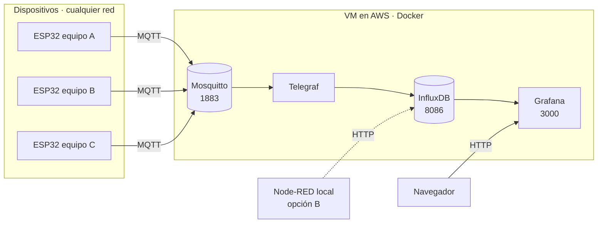

# Guía Semana 10 · Historizar el UNS: InfluxDB y Grafana en la VM

En la semana 7 dejamos un broker Mosquitto en una VM de AWS. Los dispositivos ya publican ahí y las aplicaciones móviles se conectan a él. Pero el broker **no guarda nada**: entrega cada mensaje y lo olvida. Si se pregunta «¿cuánto marcó el potenciómetro hace una hora?», nadie puede responder.

En esta guía pasamos a la siguiente etapa del eje del curso: **Adquirir → Contextualizar → _Almacenar_ → Modelar → Decidir…**

Vamos a agregar tres servicios a la misma VM, en el mismo `docker-compose.yml`:

| Servicio | Qué hace | Analogía en planta |
|---|---|---|
| **Telegraf** | Se suscribe al broker y convierte cada mensaje en un punto de la base de datos | El recolector de datos del historiador |
| **InfluxDB** | Guarda los datos ordenados por tiempo | El historiador de proceso |
| **Grafana** | Muestra tableros con gráficas e indicadores | La pantalla de supervisión |



> Todo se instala **dentro de la VM**. Las imágenes de Docker (unos 360 MB comprimidos) las descarga AWS, no su computador. Desde su equipo solo se necesita la terminal SSH y el navegador.

---

## ¿Qué es una serie de tiempo?

Una base de series de tiempo guarda **puntos**. Cada punto tiene cuatro partes:

| Parte | En InfluxDB se llama | Ejemplo | ¿Se indexa? |
|---|---|---|---|
| Qué tipo de dato es | *measurement* | `medicion` | Sí |
| De dónde viene (contexto) | *tags* (etiquetas) | `celda=llenadora`, `variable=potenciometro` | Sí |
| El valor medido | *fields* (campos) | `valor=42.5` | No |
| Cuándo | *timestamp* | `2026-11-03T13:05:12Z` | Es el eje |

Aquí se ve por qué el UNS que diseñamos en el Lab 1 era importante: **cada nivel del tópico se convierte en una etiqueta**. El contexto que pusimos en el nombre del tópico es el mismo contexto que permite filtrar en la base de datos.

```text
Tópico:   andina/cucuta/envasado/linea-1/llenadora/esp32-01/medicion/potenciometro
Mensaje:  {"valor":42.5,"unidad":"%","calidad":"buena"}
                │
                ▼  Telegraf
Punto:    medicion,empresa=andina,sitio=cucuta,area=envasado,linea=linea-1,
          celda=llenadora,dispositivo=esp32-01,variable=potenciometro,
          unidad=%,calidad=buena  valor=42.5  1762174512000
```

Esa última línea es el **protocolo de línea** (*line protocol*) de InfluxDB. Es el formato con el que se escribe en la base.

---

## Paso previo · Qué debe estar funcionando

| # | Requisito | Cómo se verifica |
|---|---|---|
| 1 | La VM está en ejecución | Consola EC2 → Instancias → *En ejecución* |
| 2 | Entra por SSH | `ssh -i clave-broker.pem ubuntu@IP_PUBLICA` |
| 3 | El broker de la semana 7 corre | `cd ~/broker-uns && docker compose ps` muestra `ai-mosquitto` *Up* |
| 4 | El broker exige credenciales | La prueba sin usuario responde `not authorised` |
| 5 | Su dispositivo publica en la **jerarquía acordada** en el Lab 1, **una variable por tópico** | MQTT Explorer muestra `…/dispositivo/medicion/<variable>` con un mensaje `{"valor":…,"unidad":…}` |

Si fallan los requisitos 1 a 4, vuelva a la guía de la semana 7: `codigo/semana-07-servidor-nube/Guia_Crear_VM_Broker.md`.

Si falla el 5, porque su dispositivo publica varias variables juntas en un solo mensaje, resuélvalo primero con el **Anexo A** al final de esta guía.

**Todos los comandos de esta guía se ejecutan dentro de la VM**, en la terminal SSH, salvo que se diga otra cosa.

---

## Paso 1 · Darle aire a la memoria (swap)

La `t3.micro` tiene 1 GiB de RAM. Los cuatro servicios en reposo usan unos 160 MB, pero al descargar y arrancar imágenes hay picos. Un archivo de intercambio (*swap*) evita que Ubuntu cierre procesos por falta de memoria.

Primero revise el espacio en disco. Debe haber **al menos 3 GB libres** (columna *Avail*):

```bash
df -h /
```

Cree un swap de 1 GB:

```bash
sudo fallocate -l 1G /swapfile
sudo chmod 600 /swapfile
sudo mkswap /swapfile
sudo swapon /swapfile
echo '/swapfile none swap sw 0 0' | sudo tee -a /etc/fstab
```

Verifique:

```bash
free -h
```

La fila `Swap:` debe mostrar `1.0Gi` de total.

| Comando | Función |
|---|---|
| `fallocate -l 1G` | Reserva un archivo de 1 GB en el disco |
| `chmod 600` | Solo `root` puede leerlo |
| `mkswap` / `swapon` | Le da formato de swap y lo activa |
| La línea en `/etc/fstab` | Hace que el swap se active solo al reiniciar la VM |

> Este paso se hace **una sola vez**. Si lo repite, `fallocate` dirá que el archivo ya existe; no pasa nada.

---

## Paso 2 · Traer los archivos de esta semana

Actualice la copia del repositorio que ya tiene en la VM:

```bash
cd ~/automatizacion-inteligente-2026-2
git pull
```

Guarde una copia del `docker-compose.yml` de la semana 7, por si necesita volver atrás:

```bash
cd ~/broker-uns
cp docker-compose.yml docker-compose.semana07.yml
```

Copie los archivos nuevos. **No se toca** la carpeta `mosquitto/`: el broker, sus usuarios y su configuración siguen iguales.

```bash
S10=~/automatizacion-inteligente-2026-2/codigo/semana-10-historizar-uns

cp $S10/docker-compose.yml  ~/broker-uns/
cp $S10/.env.ejemplo        ~/broker-uns/
cp $S10/simulador.sh        ~/broker-uns/
cp $S10/gitignore           ~/broker-uns/.gitignore
cp -r $S10/telegraf         ~/broker-uns/
cp -r $S10/grafana          ~/broker-uns/
```

La carpeta queda así:

```text
/home/ubuntu/broker-uns/
├── docker-compose.yml          ← nuevo: 4 servicios (+1 opcional)
├── docker-compose.semana07.yml ← respaldo
├── .env.ejemplo                ← plantilla de claves
├── .gitignore
├── simulador.sh                ← dispositivo de respaldo
├── grafana/provisioning/datasources/influxdb.yml
├── telegraf/telegraf.conf
└── mosquitto/config/
    ├── mosquitto.conf          ← sin cambios
    └── passwd                  ← sin cambios (por ahora)
```

Compare los dos `docker-compose.yml`. El servicio `mosquitto` es idéntico: mismo nombre de contenedor y mismos volúmenes. Por eso Docker no lo recrea y los dispositivos conectados no se enteran.

---

## Paso 3 · Las claves en el archivo `.env`

Las claves no se escriben en el `docker-compose.yml`. Van en un archivo aparte, `.env`, que Docker Compose lee solo y que **nunca se sube al repositorio**.

```bash
cp .env.ejemplo .env
openssl rand -hex 32
```

El segundo comando imprime 64 caracteres al azar. Cópielos: ese será el **token** de InfluxDB.

Abra el archivo:

```bash
nano .env
```

Cambie cada `CAMBIE_...`:

| Variable | Qué poner |
|---|---|
| `INFLUX_CLAVE` | Clave de la interfaz web de InfluxDB. **Mínimo 8 caracteres** o InfluxDB no arranca |
| `INFLUX_TOKEN` | Los 64 caracteres de `openssl rand -hex 32` |
| `MQTT_CLAVE_TELEGRAF` | Clave del usuario MQTT `telegraf` que crearemos en el paso 4 |
| `GRAFANA_CLAVE` | Clave de la interfaz web de Grafana |
| `RUTA_SIMULADOR` | Su jerarquía acordada hasta la celda (solo si usará el simulador) |

Guarde con `Ctrl+O`, `Enter` y salga con `Ctrl+X`. Proteja el archivo:

```bash
chmod 600 .env
```

> **Ojo con las comillas:** en `.env` no se usan comillas ni espacios alrededor del `=`. Escriba `GRAFANA_CLAVE=MiClave2026`, no `GRAFANA_CLAVE = "MiClave2026"`.

---

## Paso 4 · Un usuario MQTT para Telegraf

Telegraf es un cliente MQTT más y el broker no admite anónimos. Le creamos su propio usuario. Use **la misma clave** que puso en `MQTT_CLAVE_TELEGRAF`:

```bash
docker run --rm -it \
  -v "$PWD/mosquitto/config:/mosquitto/config" \
  eclipse-mosquitto:2 \
  mosquitto_passwd /mosquitto/config/passwd telegraf
```

> ⚠️ **Sin `-c`**. Con `-c` se crea un archivo nuevo y se borran los usuarios que ya existían (`profe`, los de los equipos…).

`mosquitto_passwd` reescribe el archivo, así que hay que devolverle el dueño y los permisos. Luego se reinicia el broker para que lea el usuario nuevo:

```bash
sudo chown 1883:1883 mosquitto/config/passwd
sudo chmod 600 mosquitto/config/passwd
docker compose restart mosquitto
```

Si aparecen avisos `owner is not root`, son normales con la configuración de la semana 7 y no impiden que el broker funcione.

Los dispositivos se reconectan solos en unos segundos. Ese es el trabajo del LWT y de la reconexión que programamos en el ESP32.

---

## Paso 5 · Descargar y levantar

```bash
docker compose config --quiet
```

Si no muestra nada, el archivo es válido. Si dice `variable is not set`, falta una variable en `.env`.

```bash
docker compose pull
docker compose up -d
docker compose ps
```

Deben aparecer cuatro contenedores en estado *Up*: `ai-mosquitto`, `ai-influxdb`, `ai-telegraf` y `ai-grafana`.

Revise que Telegraf se conectó al broker:

```bash
docker compose logs --tail 20 telegraf
```

Debe ver **dos** líneas como esta (una por cada entrada de `telegraf.conf`):

```text
I! [inputs.mqtt_consumer] Connected [tcp://mosquitto:1883]
```

> Telegraf escribe `tcp://mosquitto:1883`, no la IP pública. Dentro de la red de Docker los servicios se llaman por su nombre. Es la misma lección de la semana 2 con Node-RED.

> 📸 **Captura 01** · `img/01_compose-ps.png` — `docker compose ps` con los cuatro servicios *Up*.

---

## Paso 6 · Revisar el puente: `telegraf.conf`

Abra el archivo y ubique estas líneas:

```toml
topics = [
  "+/+/+/+/+/+/medicion/+",
  "+/+/+/+/+/+/salida/+",
]

[[inputs.mqtt_consumer.topic_parsing]]
  topic       = "+/+/+/+/+/+/+/+"
  measurement = "_/_/_/_/_/_/measurement/_"
  tags        = "empresa/sitio/area/linea/celda/dispositivo/_/variable"
```

| Línea | Qué dice |
|---|---|
| `topics` | Suscribirse solo a mediciones y confirmaciones de salida. Los `cmd`, `info` y `estado` no van aquí |
| `topic` | El tópico tiene **8 niveles** |
| `measurement` | El 7.º nivel (la clase: `medicion` o `salida`) es la *measurement* |
| `tags` | Cada nivel se convierte en una etiqueta con ese nombre. `_` significa «ignorar este nivel» |

Hay una segunda entrada, para `estado`, que guarda `online`/`offline`. Ese historial es la materia prima de la **disponibilidad**, la «D» del OEE, que calcularemos más adelante.

**Si la jerarquía acordada en el Lab 1 no tiene 8 niveles**, ajuste los `+` y los nombres de las etiquetas para que coincidan. Por ejemplo, con 7 niveles (sin `celda`):

```toml
topics = ["+/+/+/+/+/medicion/+", "+/+/+/+/+/salida/+"]
  topic       = "+/+/+/+/+/+/+"
  measurement = "_/_/_/_/_/measurement/_"
  tags        = "empresa/sitio/area/linea/dispositivo/_/variable"
```

Después de editar:

```bash
docker compose restart telegraf
```

---

## Paso 7 · Abrir los puertos web en AWS

En la consola de AWS: **EC2 → Instancias → su VM → Seguridad → grupo de seguridad → Editar reglas de entrada → Agregar regla**.

| Tipo | Puerto | Origen | Descripción | ¿Cuándo? |
|---|---|---|---|---|
| TCP personalizado | `3000` | `0.0.0.0/0` | Grafana | Siempre |
| TCP personalizado | `8086` | `0.0.0.0/0` | InfluxDB | Solo para la opción B (Node-RED) o para ver la interfaz web de InfluxDB |

> 📸 **Captura 02** · `img/02_reglas-3000-8086.png` — reglas de entrada con 22, 1883, 3000 y 8086.

**Para pensar:** cada puerto abierto es una puerta más hacia la VM. Por eso todos los servicios tienen usuario y clave. En la unidad de ciberseguridad veremos cómo cerrar estas puertas sin perder el acceso.

---

## Paso 8 · Que lleguen datos

Hay dos fuentes posibles. Pueden coexistir.

### Opción 1 · El ESP32 del Lab 1

Si su montaje ya apunta al broker de la VM (la tarea de esta semana) y cumple el requisito 5 del paso previo, no hay que hacer nada más. Telegraf ya está suscrito.

Si su dispositivo publica un paquete con varias variables, Telegraf no lo va a guardar. Vea el **Anexo A**.

### Opción 2 · El simulador

Si no tiene el montaje a la mano, la VM puede generar sus propios datos. El simulador publica lo mismo que `esp32_uns.ino`: estado, potenciómetro (una rampa con ruido) y pulsador. Usa la ruta de `RUTA_SIMULADOR` del `.env`.

```bash
docker compose --profile simulador up -d
```

Para detenerlo:

```bash
docker compose --profile simulador stop simulador
```

Al detenerlo publica `offline` en su tópico de estado, igual que haría el LWT de un ESP32.

> El simulador solo arranca si se pide con `--profile simulador`. Un `docker compose up -d` normal no lo levanta.

---

## Paso 9 · Comprobar que InfluxDB está guardando

Desde la VM, sin abrir ningún puerto. Cargue el token en una variable para no escribirlo:

```bash
TOKEN=$(grep INFLUX_TOKEN .env | cut -d= -f2)
```

Pregunte por el último valor de cada variable en los últimos 5 minutos:

```bash
docker exec ai-influxdb influx query --org unipamplona --token $TOKEN '
from(bucket: "uns")
  |> range(start: -5m)
  |> filter(fn: (r) => r._measurement == "medicion")
  |> group(columns: ["dispositivo", "variable"])
  |> last()
  |> keep(columns: ["_time", "dispositivo", "variable", "_value"])'
```

Debe aparecer una tabla por cada pareja dispositivo y variable, con la hora y el último valor.

Ese lenguaje se llama **Flux**. Léalo de arriba hacia abajo, como una tubería (`|>`):

| Línea | Qué hace |
|---|---|
| `from(bucket: "uns")` | De la «base» `uns`… |
| `range(start: -5m)` | …tome los últimos 5 minutos… |
| `filter(...)` | …solo las mediciones… |
| `group(...)` | …agrúpelas por dispositivo y variable… |
| `last()` | …y quédese con el último punto de cada grupo |

**La interfaz web de InfluxDB** (opcional, requiere el puerto 8086): `http://IP_PUBLICA:8086`, con `INFLUX_USUARIO` e `INFLUX_CLAVE`. En **Data Explorer** puede armar la misma consulta con clics y ver el código Flux con **Script Editor**.

> 📸 **Captura 03** · `img/03_influx-query.png` — resultado de la consulta en la terminal.

---

## Paso 10 · El tablero en Grafana

Abra `http://IP_PUBLICA:3000` y entre con `GRAFANA_USUARIO` y `GRAFANA_CLAVE`.

### 10.1 La fuente de datos ya está

**Connections → Data sources → InfluxDB-UNS**. Baje y pulse **Save & test**. Debe decir *datasource is working. 3 buckets found*.

No hubo que configurarla a mano. Grafana la creó al arrancar a partir de `grafana/provisioning/datasources/influxdb.yml`. Este mecanismo se llama **aprovisionamiento** y es lo que hace que la solución sea **reproducible**: otra persona levanta el mismo `docker-compose.yml` y obtiene el mismo Grafana.

> 📸 **Captura 04** · `img/04_datasource-ok.png` — prueba de la fuente de datos en verde.

### 10.2 Panel 1 · Entrada continua en el tiempo

**Dashboards → New → New dashboard → Add visualization → InfluxDB-UNS**.

En el editor de consultas pegue:

```flux
from(bucket: "uns")
  |> range(start: v.timeRangeStart, stop: v.timeRangeStop)
  |> filter(fn: (r) => r._measurement == "medicion" and r.variable == "potenciometro")
  |> aggregateWindow(every: v.windowPeriod, fn: mean, createEmpty: false)
  |> keep(columns: ["_time", "_value", "dispositivo"])
```

- Visualización: **Time series**.
- Título: `Entrada continua`.
- En **Standard options → Unit** elija *Percent (0-100)*.

`v.timeRangeStart`, `v.timeRangeStop` y `v.windowPeriod` los pone Grafana según el rango de tiempo elegido arriba a la derecha. `aggregateWindow` promedia por ventanas, para no dibujar miles de puntos cuando se ve una semana entera.

Pulse **Back to dashboard** y guarde el tablero (💾) con el nombre `UNS · Laboratorio`.

### 10.3 Panel 2 · Entrada discreta (último valor)

**Add → Visualization**:

```flux
from(bucket: "uns")
  |> range(start: v.timeRangeStart, stop: v.timeRangeStop)
  |> filter(fn: (r) => r._measurement == "medicion" and r.variable == "pulsador")
  |> last()
  |> keep(columns: ["_time", "_value", "dispositivo"])
```

- Visualización: **Stat**.
- En **Value mappings** agregue: `0` → `Libre` (gris) y `1` → `Presionado` (verde).

### 10.4 Panel 3 · Estado de los dispositivos

```flux
from(bucket: "uns")
  |> range(start: v.timeRangeStart, stop: v.timeRangeStop)
  |> filter(fn: (r) => r._measurement == "estado")
  |> last()
  |> keep(columns: ["_value", "dispositivo"])
```

- Visualización: **Stat**.
- En **Value options → Fields** elija *All fields*. Por defecto Stat solo muestra números y aquí el valor es un texto.
- **Value mappings**: `online` → verde, `offline` → rojo.

Desconecte el ESP32 (o detenga el simulador) y observe cuánto tarda el panel en ponerse rojo. ¿De qué depende ese tiempo?

### 10.5 Que se actualice solo

Arriba a la derecha: rango **Last 15 minutes** y actualización automática cada **5s**. Guarde el tablero.

> 📸 **Captura 05** · `img/05_tablero-grafana.png` — tablero con los tres paneles recibiendo datos.

---

## Paso 11 · Opción B: Node-RED como puente, en lugar de Telegraf

Telegraf es la herramienta típica de la industria para este trabajo, pero el puente también se puede hacer con Node-RED, que ya conocemos. Aquí Node-RED corre **en su computador**, con el stack de la semana 2, y escribe en InfluxDB por HTTP. **No hay que instalar ningún paquete adicional.**

```text
ESP32 → Mosquitto (VM) → Node-RED (su PC) → HTTP :8086 → InfluxDB (VM)
```

### 11.1 Apagar Telegraf

Si los dos puentes trabajan al tiempo, cada dato se guarda dos veces. En la VM:

```bash
docker compose stop telegraf
```

### 11.2 Importar el flujo

En su computador, con el stack de la semana 2 levantado, abra `http://localhost:1880` → menú ☰ → **Import** → seleccione `codigo/semana-10-historizar-uns/node-red/flujo-uns-a-influxdb.json` → **Import**.

Edite tres cosas:

| Nodo | Qué cambiar |
|---|---|
| **Bróker UNS nube** (doble clic en un nodo MQTT → lápiz) | *Connection → Server*: IP pública de la VM. *Security*: usuario y clave MQTT |
| **A protocolo de línea** (función) | Las tres primeras líneas: `HOST`, `ORG` y `BUCKET` |
| **Escribir en InfluxDB** (petición HTTP) | *Token*: el `INFLUX_TOKEN` del `.env` |

El token va en el nodo HTTP y no en la función por una razón: Node-RED guarda las credenciales aparte, así que **no quedan dentro del flujo cuando lo exporta** a su repositorio.

Pulse **Deploy**. Debajo del nodo **¿204?** debe aparecer `204 · escrito` en verde. El código HTTP 204 significa «recibido, no tengo nada que responder». Es la respuesta normal de InfluxDB cuando escribe bien.

> 📸 **Captura 06** · `img/06_nodered-204.png` — flujo con el estado `204 · escrito`.

### 11.3 Comparar

Lea la función **A protocolo de línea**. Hace a mano lo mismo que Telegraf hace con `topic_parsing`: parte el tópico, arma las etiquetas y escribe una línea.

| | Telegraf (opción A) | Node-RED (opción B) |
|---|---|---|
| Dónde corre | En la VM, junto al broker | En un computador del laboratorio |
| Configuración | Un archivo `.conf`, sin programar | Un flujo con una función en JavaScript |
| Si se apaga el PC del laboratorio | Sigue guardando | **Deja de guardar** |
| Transformaciones complejas | Limitadas | Cualquier lógica |

**Para pensar:** ¿dónde conviene ubicar el puente en una planta real? Este es justamente el debate entre cómputo en el **borde**, la **niebla** o la **nube**.

Al terminar, vuelva a la opción A:

```bash
docker compose start telegraf
```

---

## Paso 12 · Al terminar la sesión

| Acción | Comando o lugar | ¿Se pierden datos? |
|---|---|---|
| Detener solo el simulador | `docker compose --profile simulador stop simulador` | No |
| Apagar todos los servicios | `docker compose down` | No, quedan en los volúmenes |
| Detener la VM | Consola EC2 → **Estado → Detener** | No, pero **cambia la IP pública** |
| Borrar los datos históricos | `docker compose down -v` | ⚠️ **Sí, todo**: InfluxDB, Grafana y los mensajes retenidos |

InfluxDB borra sola los datos con más de 30 días (`DOCKER_INFLUXDB_INIT_RETENTION: 30d`). Así el disco de 8 GB no se llena.

---

## Errores frecuentes

| Síntoma | Causa |
|---|---|
| `variable is not set` al hacer `docker compose config` | Falta esa variable en `.env`, o el archivo se llama distinto (`.env.txt`, `env`) |
| `ai-influxdb` se reinicia en bucle | `INFLUX_CLAVE` tiene menos de 8 caracteres. Corríjala y ejecute `docker compose down -v && docker compose up -d` (la configuración inicial solo se aplica con el volumen vacío) |
| Telegraf: `not Authorized` | El usuario `telegraf` no existe en `passwd`, la clave no coincide con `.env`, o faltó `docker compose restart mosquitto` |
| Los dispositivos de los equipos dejaron de conectar | Se usó `mosquitto_passwd -c` y se borraron los usuarios. Vuelva a crearlos |
| Telegraf conectado pero InfluxDB sin datos | La jerarquía no tiene 8 niveles o la clase no se llama `medicion`. Revise el paso 6 |
| Telegraf: `unauthorized access` al escribir | `INFLUX_TOKEN` se cambió en `.env` después del primer arranque. InfluxDB conserva el token original |
| Grafana no abre en el navegador | Falta la regla del puerto 3000 en el grupo de seguridad |
| Grafana: *datasource is not working* | El token cambió (ver arriba) o InfluxDB no ha terminado de arrancar. Espere 30 s y pruebe de nuevo |
| Panel vacío en Grafana | El rango de tiempo no cubre los datos, o la variable se llama distinto (`potenciometro` frente a `pot`) |
| Node-RED: estado `401` | Token mal copiado en el nodo **Escribir en InfluxDB** |
| Node-RED: estado `ECONNREFUSED` o *timeout* | Falta la regla del puerto 8086, o la IP en `HOST` está mal |
| Node-RED: `404` | `ORG` o `BUCKET` no coinciden con el `.env` |
| Todo funcionaba y hoy no abre nada | Se detuvo la VM y cambió la IP pública. Actualícela en los clientes |
| La VM se pone muy lenta | Revise `free -h`. Si el swap no aparece, repita el paso 1 |

---

## Bitácora de hoy

- ¿Por qué los textos (`unidad`, `calidad`) quedaron como etiquetas y el número como campo? ¿Qué pasaría si fuera al revés?
- El ESP32 publica el potenciómetro cada 2 s. En un mes, ¿cuántos puntos son? ¿Necesita esa resolución para todo el mes?
- Si el broker se cae 10 minutos, ¿qué datos se pierden y cuáles no? ¿Cambia la respuesta con la opción B?
- ¿Qué información del estado `online`/`offline` serviría para calcular cuánto tiempo estuvo disponible una máquina?

---

## Anexo A · Dispositivos que publican varias variables en un solo mensaje

Algunos montajes usan el ESP32 como **pasarela**: otro controlador (un Arduino, un PLC) lee las señales y le envía al ESP32 una trama con todo junto, por serie o RS485. Lo más sencillo es publicar esa trama tal cual:

```text
…/estacion-1/datos   →   {"T1":24.5,"in1":1,"out1":0,"fase":3}
```

Funciona, pero **no cumple el espacio de nombres acordado**, y eso tiene un costo:

| Prueba de diseño (Tema 4) | Con la trama en un solo tópico |
|---|---|
| 1 · Una suscripción trae toda una clase | ❌ `+/+/+/+/+/+/medicion/#` no la encuentra: no hay niveles de dispositivo, clase ni variable |
| 3 · Un consumidor nuevo ve el dispositivo sin cambios | ❌ Cada consumidor (Telegraf, Grafana, un modelo de aprendizaje automático) necesita una regla especial solo para ese equipo |

Ese segundo punto es la **integración punto a punto** que el UNS existe para evitar. La regla de la industria es que **el dispositivo se adapta al espacio de nombres, no cada consumidor al dispositivo**.

### A.1 La solución: desempaquetar en el ESP32

El ESP32 sigue recibiendo la misma trama. El otro controlador no cambia. Lo único que cambia es cómo el ESP32 la publica: **una variable por tópico**, con su clase y su unidad.

```text
{"T1":24.5,"in1":1,"out1":0,"fase":3}
        │
        ▼  ESP32
…/estacion-1/esp32-01/medicion/temperatura      {"valor":24.50,"unidad":"C"}
…/estacion-1/esp32-01/medicion/confirmacion-1   {"valor":1.00,"unidad":"bool"}
…/estacion-1/esp32-01/salida/rele-1             {"valor":0.00,"unidad":"bool"}   (retenido)
…/estacion-1/esp32-01/medicion/fase             {"valor":3.00,"unidad":"num"}
```

### A.2 El código

Agregue esto al programa del ESP32, después de crear el objeto `mqtt`. No requiere librerías adicionales.

```cpp
// ── Desempaquetar la trama: una variable por tópico ─────────────────
// Ruta acordada hasta el dispositivo, sin barra al final
#define BASE_UNS "unipamplona/villa-del-rosario/lab-automatizacion/banco-x/estacion-1/esp32-01"

struct Senal {
  const char* llave;      // nombre dentro de la trama
  const char* clase;      // medicion o salida
  const char* variable;   // nombre en el UNS: minúsculas y guiones
  const char* unidad;
};

// Una fila por cada valor de la trama. CAMBIE ESTA TABLA por la suya.
const Senal SENALES[] = {
  // llave     clase        variable           unidad
  { "T1",     "medicion",  "temperatura",     "C"    },
  { "in1",    "medicion",  "confirmacion-1",  "bool" },
  { "out1",   "salida",    "rele-1",          "bool" },
  { "fase",   "medicion",  "fase",            "num"  },
};
const int N_SENALES = sizeof(SENALES) / sizeof(SENALES[0]);

// Busca "llave": número dentro del JSON. Devuelve false si no lo encuentra.
bool extraerNumero(const char* json, const char* llave, float& valor) {
  char patron[24];
  snprintf(patron, sizeof(patron), "\"%s\"", llave);
  const char* p = strstr(json, patron);
  if (!p) return false;
  p = strchr(p + strlen(patron), ':');
  if (!p) return false;
  char* fin;
  valor = strtof(p + 1, &fin);
  return fin != p + 1;               // false si después de ':' no hay número
}

void publicarDesempaquetado(const char* json) {
  char topico[160], mensaje[64];
  for (int i = 0; i < N_SENALES; i++) {
    float v;
    if (!extraerNumero(json, SENALES[i].llave, v)) continue;
    snprintf(topico, sizeof(topico), "%s/%s/%s",
             BASE_UNS, SENALES[i].clase, SENALES[i].variable);
    snprintf(mensaje, sizeof(mensaje), "{\"valor\":%.2f,\"unidad\":\"%s\"}",
             v, SENALES[i].unidad);
    bool retener = (strcmp(SENALES[i].clase, "salida") == 0);  // salidas retenidas
    mqtt.publish(topico, mensaje, retener);
  }
}
```

Y en la función que recibe la trama, donde hoy se publica el JSON completo:

```cpp
// Antes:
mqtt.publish(TOPICO_DATOS, jsonLimpio.c_str());

// Ahora:
publicarDesempaquetado(jsonLimpio.c_str());
```

Si un valor de la trama no es un número (por ejemplo, `"T1":"error"`), esa variable simplemente no se publica en ese ciclo. Las demás sí.

### A.3 Lo demás también entra en la jerarquía

| Hoy | Debe quedar | Por qué |
|---|---|---|
| `…/estacion-1/estado` | `…/estacion-1/esp32-01/estado` | El estado es **del dispositivo**. Cambie también el tópico del LWT en `mqtt.connect(...)` |
| Una sola orden para todo (`…/PC` con `{"start":1}`) | `…/esp32-01/cmd/<variable>`, por ejemplo `cmd/arranque` o `cmd/rele-1` | Clase `cmd`, una orden por tópico, **QoS 1 y sin retener** |
| Llave `estado` dentro de la trama (fase de una máquina de estados) | `medicion/fase` | En el UNS, `estado` significa `online`/`offline`. Otro significado confunde |
| Nombres con mayúsculas (`PC`, `TEMP`) | `cmd/arranque`, `medicion/temperatura` | Regla de nombrado: todo en minúsculas |

### A.4 Cómo verificar

1. Suscríbase con la prueba de diseño 1. Debe ver **todas** sus mediciones con una sola suscripción:

   ```bash
   docker exec ai-mosquitto mosquitto_sub -u profe -P 'SU_CLAVE' \
     -t '+/+/+/+/+/+/medicion/#' -v
   ```

2. Repita el **paso 9**. Sus variables deben aparecer en InfluxDB sin que nadie haya tocado `telegraf.conf`. Esa es la prueba de que el diseño funciona.

3. Actualice su tablero de Node-RED para que lea los tópicos nuevos. Mientras lo hace puede publicar las dos formas al tiempo, pero la entrega debe quedar solo con la jerarquía acordada.

---

## Referencias

- Plugin `mqtt_consumer` de Telegraf (incluye `topic_parsing`): <https://github.com/influxdata/telegraf/tree/master/plugins/inputs/mqtt_consumer>
- Formato JSON en Telegraf: <https://github.com/influxdata/telegraf/tree/master/plugins/parsers/json>
- Salida `influxdb_v2` de Telegraf: <https://github.com/influxdata/telegraf/tree/master/plugins/outputs/influxdb_v2>
- Imagen oficial de InfluxDB 2 y variables `DOCKER_INFLUXDB_INIT_*`: <https://hub.docker.com/_/influxdb>
- Protocolo de línea de InfluxDB: <https://docs.influxdata.com/influxdb/v2/reference/syntax/line-protocol/>
- API de escritura de InfluxDB 2: <https://docs.influxdata.com/influxdb/v2/write-data/developer-tools/api/>
- Introducción a Flux: <https://docs.influxdata.com/influxdb/v2/query-data/get-started/>
- Grafana con InfluxDB: <https://grafana.com/docs/grafana/latest/datasources/influxdb/>
- Aprovisionamiento de Grafana: <https://grafana.com/docs/grafana/latest/administration/provisioning/>
- Swap en Ubuntu: <https://help.ubuntu.com/community/SwapFaq>
